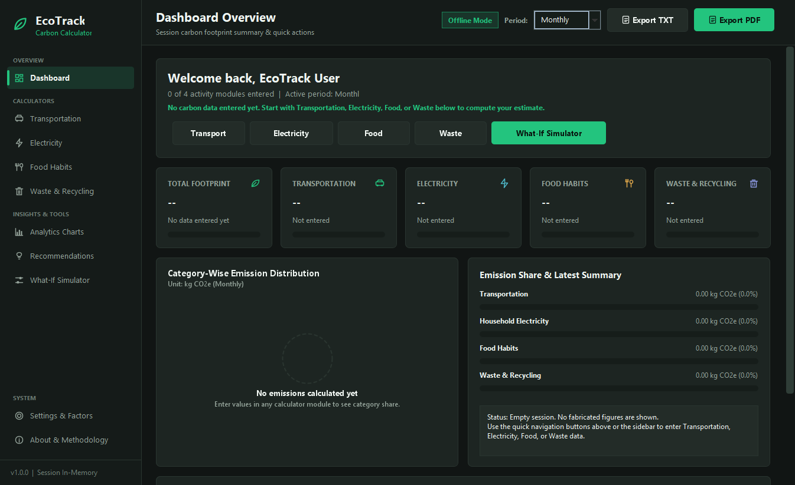
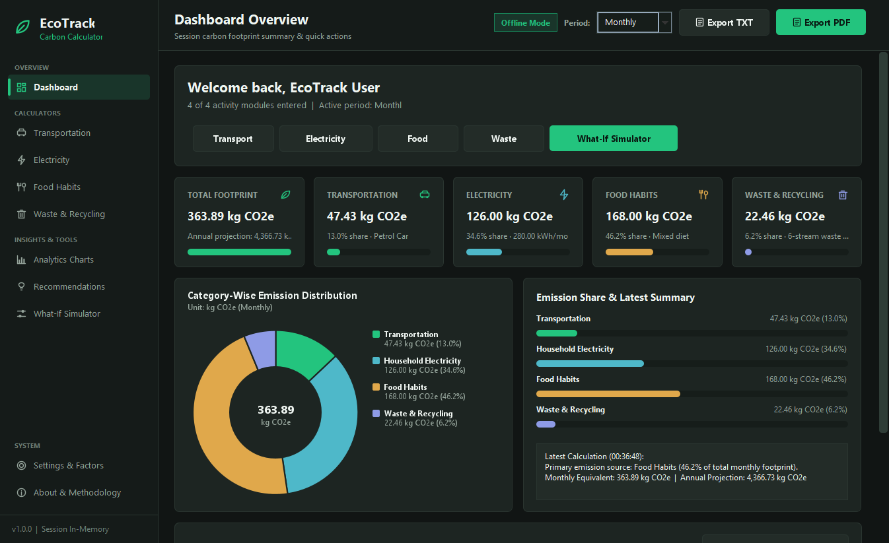
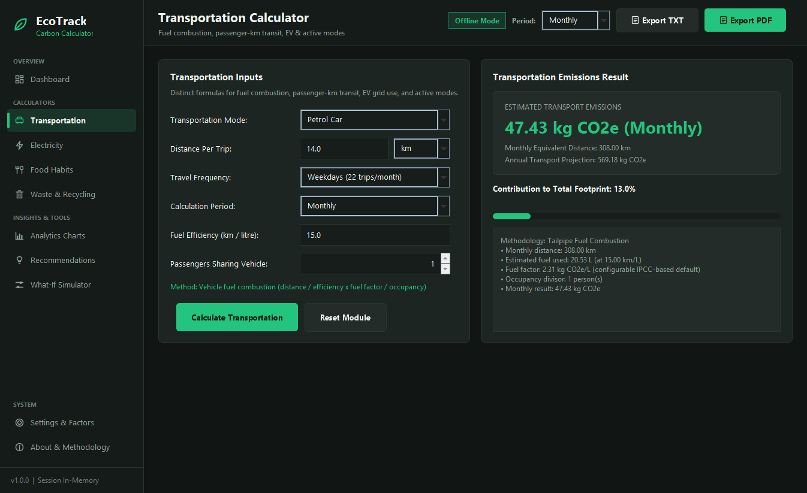
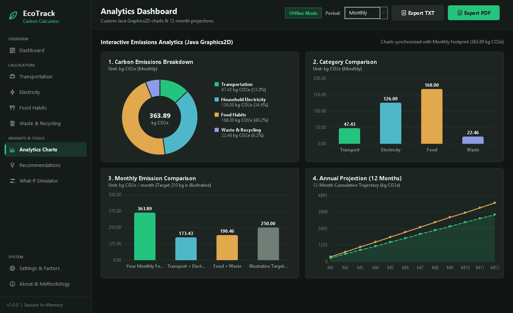
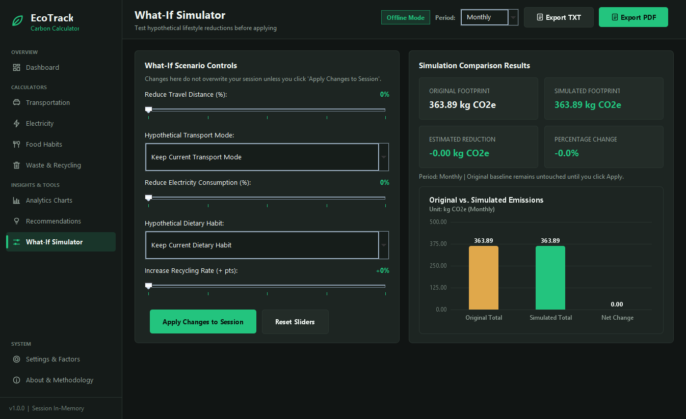
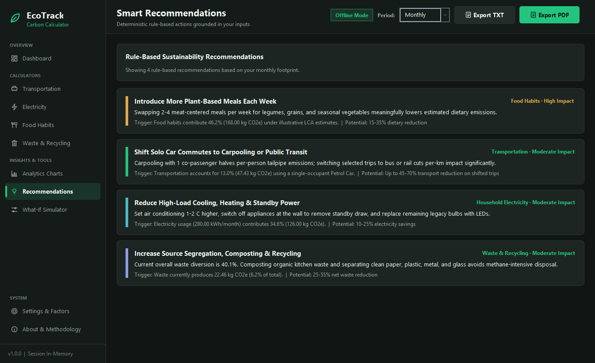

# EcoTrack – Personal Carbon Footprint Calculator

**EcoTrack** is a standalone, offline **Java Swing** desktop application designed to help individuals estimate, visualize, simulate, and report their personal greenhouse gas (GHG) footprint in kilograms of carbon dioxide equivalent ($\text{kg CO}_2\text{e}$).

---

## 1. Project Overview
Modern sustainability awareness requires accessible tools that translate everyday habits—commuting, household electricity use, dietary choices, and waste generation—into transparent carbon estimates. EcoTrack performs all calculations, custom **Java Graphics2D** visualizations, rule-based recommendations, What-If lifestyle simulations, and **PDF/TXT** report exports locally inside the JVM without requiring any database, server, or internet connection.

---

## 2. Problem Statement
Most personal carbon calculators rely on web servers, user accounts, or external APIs, and frequently present final numbers without disclosing units, unit conversions, or emission factor assumptions. Students and individuals need a self-contained desktop utility that:
- Operates completely offline with zero external database dependencies.
- Separates transport, electricity, food, and waste methodologies transparently.
- Distinguishes illustrative reference assumptions from verified regional factors.
- Demonstrates clean object-oriented desktop engineering using Java Swing and Graphics2D.

---

## 3. Objectives
- Estimate personal GHG emissions ($\text{kg CO}_2\text{e}$) across **Transportation**, **Household Electricity**, **Food Habits**, and **Waste & Recycling**.
- Provide an intuitive, modern dark-charcoal & emerald-green desktop interface with honest empty states.
- Render responsive, interactive **Java Graphics2D** charts (pie/donut, bar comparison, monthly benchmark comparison, and 12-month projection).
- Deliver deterministic rule-based recommendations grounded directly in user inputs.
- Offer a non-destructive **What-If Simulator** to evaluate potential lifestyle changes before applying them.
- Export complete **PDF** and **TXT** reports locally via `JFileChooser`.

---

## 4. Features
- **Dashboard Overview:** KPI summary cards, category distribution donut chart, share progress bars, environmental tips, quick navigation buttons, and empty-state guidance.
- **Transportation Calculator:** Supports 8 modes (`Petrol Car`, `Diesel Car`, `Motorcycle`, `Bus`, `Train`, `Electric Vehicle`, `Bicycle`, `Walking`), `km` / `miles` conversion, frequency scaling, vehicle fuel efficiency (`km/L`), EV electricity draw (`kWh/100 km`), and vehicle occupancy sharing.
- **Electricity Calculator:** Monthly `kWh` entry, selectable illustrative grid presets (`0.82`, `0.45`, `0.15` $\text{kg CO}_2\text{e/kWh}$), and **Custom User-Entered Factor** input with source documentation.
- **Food Footprint Calculator:** Evaluates `Plant-based`, `Vegetarian`, `Mixed`, and `Meat-heavy` dietary baselines or customizable weekly meal counts with clear approximation disclaimers.
- **Waste & Recycling Calculator:** Evaluates 6 streams (`Organic`, `Paper`, `Plastic`, `Metal`, `Glass`, `General`) and partitions diverted vs. disposed mass cleanly to prevent double counting.
- **Analytics Dashboard:** Four interactive `Graphics2D` charts with hover tooltips, units, legends, and empty states.
- **Rule-Based Smart Recommendations:** Prioritized (`High`, `Moderate`, `Habit Refinement`) suggestions generated strictly from active user inputs.
- **What-If Lifestyle Simulator:** Adjust travel distance, transport mode, electricity consumption, diet, and recycling rate in real time without mutating active session values unless explicitly applied.
- **Offline PDF & TXT Export:** Pure-Java multi-page PDF 1.4 writer (embedding rendered chart images, tables, methodology, factor references, and disclaimers) plus clean UTF-8 TXT export using `SwingWorker`.
- **Settings & About:** In-memory session profile, editable emission factor registry, session reset, and academic documentation.

---

## 5. Technology Stack
- **Language:** Java (JDK 17+ target; verified on OpenJDK 25.0.2)
- **Desktop GUI:** Java Swing (`javax.swing`) & AWT
- **Charts & Vector Icons:** Java `Graphics2D` (`Arc2D`, `Path2D`, `BasicStroke`, anti-aliased rendering)
- **PDF Generation:** Self-contained pure-Java PDF 1.4 writer (`PdfDocumentWriter` with `DeflaterOutputStream` Flate compression)
- **Build & Testing:** Apache Maven (`pom.xml`) and JUnit 4 (`junit:junit:4.13.2`)
- **Database / Backend:** None (strictly offline in-memory session state)

---

## 6. Architecture
EcoTrack follows a layered modular architecture separating domain models, calculation engines, services, custom components, utilities, and Swing UI panels:
- `com.ecotrack.main` — Application entry point (`EcoTrackApp`) launching on Swing's EDT.
- `com.ecotrack.model` — Domain state & immutable result records (`ActivityData`, `CarbonResult`, `EmissionCategory`, `EmissionFactorInfo`, `Recommendation`, `SimulationScenario`, `SimulationResult`, `UserProfile`).
- `com.ecotrack.calculation` — Centralized `CarbonCalculator`, four specialized calculators (`TransportCalculator`, `ElectricityCalculator`, `FoodCalculator`, `WasteCalculator`), and configurable `EmissionFactors`.
- `com.ecotrack.service` — `AnalyticsService`, `RecommendationService`, `SimulationService`, and `ReportService`.
- `com.ecotrack.components` — Reusable Swing widgets (`Sidebar`, `HeaderPanel`, `StatCard`, `CustomButton`, `CustomPieChart`, `CustomBarChart`, `CustomProjectionChart`, `CustomProgressBar`, `StyledCardPanel`).
- `com.ecotrack.ui` — `MainFrame` and 10 functional application panels.
- `com.ecotrack.utils` — `ThemeManager`, `InputValidator`, `NumberFormatter`, `IconFactory`, and `PdfDocumentWriter`.

---

## 7. Project Structure
```text
EcoTrack-Personal-Carbon-Footprint-Calculator/
├── src/
│   ├── main/java/com/ecotrack/
│   │   ├── main/          EcoTrackApp.java
│   │   ├── model/         ActivityData.java, CarbonResult.java, EmissionCategory.java, ...
│   │   ├── calculation/   CarbonCalculator.java, TransportCalculator.java, ElectricityCalculator.java, ...
│   │   ├── service/       AnalyticsService.java, RecommendationService.java, SimulationService.java, ReportService.java
│   │   ├── components/    Sidebar.java, HeaderPanel.java, StatCard.java, CustomPieChart.java, ...
│   │   ├── ui/            MainFrame.java, DashboardPanel.java, TransportPanel.java, ...
│   │   └── utils/         ThemeManager.java, InputValidator.java, NumberFormatter.java, IconFactory.java, PdfDocumentWriter.java
│   └── test/java/com/ecotrack/
│       ├── calculation/   TransportCalculatorTest.java, ElectricityCalculatorTest.java, FoodCalculatorTest.java, WasteCalculatorTest.java, CarbonCalculatorTest.java
│       ├── service/       RecommendationServiceTest.java, SimulationServiceTest.java, ReportServiceTest.java
│       ├── utils/         InputValidatorTest.java
│       └── ui/            MainFrameNavigationTest.java
├── assets/screenshots/    Application screenshots captured from the running Swing UI
├── documentation/
│   ├── PROJECT_EXPLANATION.md
│   └── VIVA_QUESTIONS.md
├── build-and-run.bat
├── pom.xml
├── .gitignore
└── README.md
```

---

## 8. Installation & How to Run

### Prerequisites
- Java Development Kit (**JDK 17 or newer**)
- Optional: **Apache Maven 3.8+**

### Option A: Using Maven
```bash
mvn test
mvn compile exec:java
```

### Option B: Direct JDK Compilation (Windows)
Run the included batch script:
```bat
build-and-run.bat
```
Or manually with `javac` / `java`:
```bash
mkdir -p out/main
javac --release 17 -encoding UTF-8 -d out/main $(find src/main/java -name "*.java")
java -cp out/main com.ecotrack.main.EcoTrackApp
```

---

## 9. Calculation Methodology
All estimates follow the general structure:
$$\text{Emissions (kg CO}_2\text{e)} = \text{Activity Data} \times \text{Emission Factor}$$

1. **Transportation:**
   - *Fuel-combustion vehicles (Petrol Car, Diesel Car, Motorcycle):* $\text{Emissions} = \frac{(\text{Monthly km} / \text{km per L}) \times \text{Fuel Factor}}{\text{Occupancy}}$
   - *Public transit (Bus, Train):* $\text{Emissions} = \text{Monthly km} \times \text{Passenger-km Factor}$
   - *Electric Vehicle:* $\text{Emissions} = \frac{(\text{Monthly km} / 100) \times \text{kWh per 100 km} \times \text{Grid Factor}}{\text{Occupancy}}$
   - *Bicycle & Walking:* $0.0\ \text{kg CO}_2\text{e}$ direct operational emissions.
2. **Electricity:** $\text{Monthly Emissions} = \text{Monthly kWh} \times \text{Grid Factor}$; Annual Projection $= \text{Monthly} \times 12$.
3. **Food:** Representative dietary daily baseline ($\times 30$) or custom weekly meal counts ($\times \frac{52}{12}$).
4. **Waste:** Total weekly stream mass $M$ is partitioned into $M_{\text{diverted}} = M \times (\text{recycling\%}/100)$ and $M_{\text{disposed}} = M - M_{\text{diverted}}$ before applying separate factors—eliminating double counting.

---

## 10. Emission Factor References
All factors are inspectable and editable in **Settings & Factors** (`EmissionFactors.java`):
- **Petrol / Diesel Fuel Combustion (`2.31` / `2.68 kg CO2e/L`):** Configurable fuel stoichiometry defaults inspired by IPCC 2006 Guidelines (Vol. 2, Mobile Combustion).
- **Bus / Rail Transit (`0.089` / `0.041 kg CO2e/passenger-km`):** Illustrative configurable occupancy-averaged passenger-km benchmarks.
- **Electricity Grid Presets (`0.82` Coal-Heavy, `0.45` Mixed, `0.15` Low-Carbon `kg CO2e/kWh`):** Explicitly labelled **illustrative configurable scenarios**—*not* presented as official Indian or national grid emission factors. Users can enter exact local utility, CEA, EPA, or DEFRA factors via Custom mode.
- **Dietary Baselines & Meal Factors:** Illustrative LCA-inspired approximations (`2.50` to `8.20 kg CO2e/day`), explicitly documented as rough planning estimates.
- **Waste Stream Factors:** Illustrative net landfill disposal vs. recycling/composting processing factors.

---

## 11. Screenshots

| Empty State Dashboard | Populated Dashboard |
| :---: | :---: |
|  |  |

| Transportation Calculator | Graphics2D Analytics Charts |
| :---: | :---: |
|  |  |

| What-If Simulator | Rule-Based Recommendations |
| :---: | :---: |
|  |  |

---

## 12. Limitations
- **Session-Only Memory:** By design (zero database/backend requirement), entered activity inputs are cleared when the application closes; use **Export PDF** or **Export TXT** to save results.
- **Approximation Accuracy:** Dietary and waste defaults are illustrative literature-aligned estimates rather than personalized supply-chain audits.
- **Single Primary Commute Entry:** The Transportation module models one primary mode/frequency at a time rather than a multi-leg trip log.

---

## 13. Future Enhancements
- Multi-leg transportation trip list within a single session.
- Optional local encrypted JSON profile import/export.
- Regional electricity factor packs selectable by country/utility release year.
- Household per-capita normalization toggle across all four modules.

---

## 14. Team Members & Academic Details
- **Institution:** RNS Institute of Technology, Department of Computer Science and Engineering, Bengaluru, Karnataka
- **Academic Year:** 2026–2027
- **Project Guide:** Mrs Vinutha H.

**Team Members:**
1. **Pavan Chakravarti** – `1IB25CS142`
2. **Parikshith R** – `1IB25CS140`
3. **Avijeet Singh** – `1RN25CS047`
4. **Ashutosh Fobba** – `1RN25CS045`
